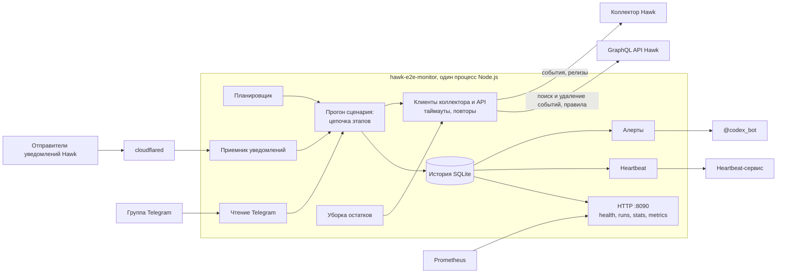
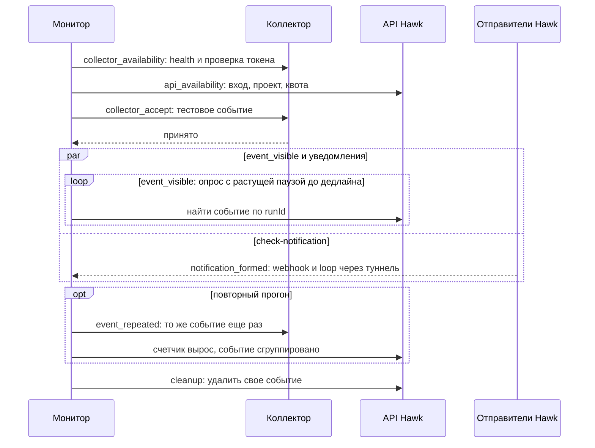

# hawk-e2e-monitor

Синтетический E2E-мониторинг для [Hawk](https://hawk.so). Сервис работает
отдельно от Hawk и не зависит от его деплоев. По расписанию он отправляет
тестовые события через публичный интерфейс интеграции и проверяет весь путь:
коллектор принял событие, воркеры его обработали, событие видно в нужном
проекте через API, Hawk прислал уведомление. О падении проверки монитор пишет
в Telegram через @codex_bot: какой этап упал, кто вероятный виновник и сколько
длился каждый этап.

| Сценарий | Что проверяет | По умолчанию |
|---|---|---|
| send-and-receive-event | событие по HTTP или WebSocket принято, обработано и видно с нужными полями, повторное событие группируется | каждые 10 минут |
| check-notification | Hawk сформировал уведомление и отправил его в каналы webhook и loop, правило с порогом срабатывает на втором событии | каждые 10 минут |
| sourcemaps | релиз с source map сохранен, событие этого релиза указывает на исходный файл и строку | раз в час |
| sentry-envelope | событие, отправленное так, как это делает Sentry SDK, доходит до Hawk | раз в час |
| telegram-delivery | уведомление Hawk доходит до чата в Telegram | выключен, нужен бот |
| endpoints-probe | коллектор, API и Garage отвечают, события не отправляются | выключен |
| new-project | коллектор принимает токен нового проекта | выключен, только для своего Hawk |

Любой сценарий можно запустить вручную для диагностики.

## Что нужно от Hawk

> [!IMPORTANT]
> Монитору нужен доступ к работающему Hawk: hawk.so или своему экземпляру.

- Отдельный проект для монитора, без правила группировки, которое ловит
  заголовки, начинающиеся с `[e2e:`.
- Integration token этого проекта.
- Аккаунт (email и пароль) с правами админа воркспейса. Через него монитор
  читает события по GraphQL API, удаляет свои тестовые события и управляет
  своими правилами уведомлений.

В Garage создайте проект. Его id есть в адресе страницы проекта
(`/project/<id>`, 24 hex-символа), токен в Settings, Integrations. Админа
назначают в настройках воркспейса: Settings, Team, Grant Admin.

Для check-notification и telegram-delivery нужны еще две вещи. Первая:
публичный https-адрес приемника уведомлений, потому что Hawk отправляет webhook
и loop только на публичные адреса. Подойдет quick tunnel cloudflared без
аккаунта, compose поднимает его сам. Вторая: в Hawk должны работать notifier и
отправители webhook и loop (на hawk.so они работают).

> [!WARNING]
> Секрет приемника входит в адреса каналов правила. Его видят все участники
> воркспейса в настройках проекта, а отправитель Hawk пишет адрес в свои логи.
> Поэтому проект и воркспейс должны быть отдельными.

## Быстрый старт в Docker Compose

Нужны Docker Engine 25+ с Compose 2.24+ (или podman 5 с `podman compose`).

```sh
git clone https://github.com/wFeeL/hawk-e2e-monitor.git
cd hawk-e2e-monitor
cp .env.example .env
```

Минимум, который нужно заполнить в `.env`:

| Переменная | Значение |
|---|---|
| `INSTANCE_ID` | имя этого монитора: 1-32 символа `a-z`, `0-9`, `-`, не больше 12 цифр, без имени сценария внутри; попадает в каждое тестовое событие |
| `HAWK_API_URL` | адрес GraphQL, для hawk.so `https://api.hawk.so/graphql` |
| `HAWK_COLLECTOR_URL` | для hawk.so пусто (адрес берется из токена), иначе адрес коллектора |
| `HAWK_PROJECT_ID`, `HAWK_INTEGRATION_TOKEN` | отдельный проект и его токен |
| `HAWK_EMAIL`, `HAWK_PASSWORD` | аккаунт админа воркспейса |
| `RECEIVER_SECRET` | от 32 символов `A-Z`, `a-z`, `0-9`, `_`, `-`, например `openssl rand -hex 24`; нужен, если в `SCENARIOS` есть check-notification или telegram-delivery (по умолчанию есть) |
| `ALERT_NOTIFY_URL` | адрес, который @codex_bot выдает на `/notify_start` (см. [Алерты](#алерты)); если пусто, алерты пишутся только в лог |

`TUNNEL_METRICS_URL` и `PUBLIC_BASE_URL` оставьте пустыми: compose сам
направит монитор на контейнер cloudflared. Значения, в которых есть `$`,
берутся в одинарные кавычки.

```sh
docker compose up -d --build
docker compose ps                  # monitor становится healthy примерно за 15 с
docker compose logs -f monitor     # первые прогоны начинаются сразу
docker compose exec monitor node dist/main.js history --limit 10
```

Если конфигурация неверна, монитор не стартует и пишет в лог, какая переменная
не так.

<details>
<summary>Hawk на том же хосте</summary>

Укажите в `HAWK_API_URL` и `HAWK_COLLECTOR_URL` адрес `host.docker.internal`.
В Docker на Linux это адрес моста `docker0`, поэтому Hawk, опубликованный
только на `127.0.0.1`, соединение отклонит. Опубликуйте Hawk и на адресе моста
или подключите монитор к сети контейнеров Hawk через compose override и
обращайтесь к ним по именам сервисов.

</details>

## Архитектура



Монитор работает с Hawk только через публичные интерфейсы: коллектор, GraphQL
API и каналы уведомлений. Доступ к базам и очередям Hawk ему не нужен, поэтому
одна и та же сборка работает и с hawk.so, и с локальным Hawk.

### Один прогон

Прогон состоит из этапов. У каждого этапа свой таймаут, он записывает
длительность и детали и либо проходит, либо завершает прогон с классом ошибки.



Остальные сценарии используют те же этапы и добавляют свои: `notification_setup`, `notification_formed` и `threshold_formed`
(check-notification), `release_uploaded` и `release_saved`
(sourcemaps), `telegram_delivered` и `telegram_probe` (telegram-delivery),
`project_created` и `token_accepted` (new-project), `garage_availability`
(endpoints-probe).

Монитор ждет условие, а не фиксированное время: опрашивает API с растущей
паузой до дедлайна этапа. Сетевые ошибки и ответы 5xx повторяются
(`RETRY_ATTEMPTS`, `RETRY_DELAYS_MS`) только там, где повтор ничего не сделает
дважды: чтение API, вход, обновление и удаление правил, удаление события.
Событие, которое коллектор мог получить, повторно не отправляется. У всего
прогона есть общий лимит `RUN_TIMEOUT_MS`, и проверка конфигурации не пропустит
таймауты этапов, которые в него не помещаются.

### Изоляция тестовых данных

У каждого прогона свой случайный `runId`. Заголовок события
`[e2e:<INSTANCE_ID>] <runId> <scenario>`, те же поля лежат в `context`. Hawk
группирует события по заголовку, поэтому каждый прогон создает новое событие и
прогоны не видят чужих событий. Два монитора с разными `INSTANCE_ID` могут
работать в одном проекте. Очистка удаляет только событие своего прогона.
События, оставшиеся от прерванных прогонов, раз в час удаляет уборка
(`SWEEP_INTERVAL_MS`).

Правила уведомлений монитор заводит сам: фильтр включения у них ровно
`[e2e:<INSTANCE_ID>]`. Все правила с таким фильтром монитор считает своими и
меняет, поэтому вручную такие правила не создавайте. Notifier Hawk кэширует
правила около минуты, поэтому прогон, который изменил правило, один раз
пропускает этап уведомления (`RULE_CACHE_WARMUP_MS`). Если такой пропуск
случается три прогона подряд, прогон считается упавшим с
`provisioning_unstable`.

### Ошибки и диагностика

Упавший прогон получает один из 58 классов ошибки, например
`collector_unavailable`, `quota_exhausted`, `event_not_found`,
`notification_timeout`. К классу прилагаются понятное сообщение и вероятный
виновник: `hawk`, `monitor`, `config` или `network`. В результате сохраняются
детали каждого этапа, секреты в них замаскированы.

### Хранение

История лежит в SQLite (`DATABASE_PATH`, в compose том `monitor-data`): прогоны,
этапы, состояние алертов и их очередь. Она переживает рестарты и обновления
образа, старые прогоны удаляются через `HISTORY_RETENTION_DAYS`. Lease в той же
базе не дает двум `serve` работать с ней одновременно. Расписание считается от
последнего прогона в истории, поэтому рестарт его не сбрасывает.

<details>
<summary>Структура кода</summary>

| Каталог | Содержимое |
|---|---|
| `src/config` | переменные окружения, проверка через zod при старте |
| `src/clients` | клиенты коллектора, API Hawk, Telegram, Garage и @codex_bot, у каждого вызова таймаут |
| `src/engine` | этапы, дедлайны, опрос, результаты прогона |
| `src/scenarios` | по каталогу на сценарий, общие этапы в `shared` |
| `src/notifications`, `src/receiver` | правила уведомлений и приемник |
| `src/scheduler`, `src/serve` | расписание и долгоживущий процесс |
| `src/storage` | история, lease и состояние в SQLite |
| `src/alerting`, `src/heartbeat`, `src/metrics` | алерты, heartbeat, метрики Prometheus |
| `src/errors` | классы ошибок, сообщения, маскирование секретов |
| `src/commands`, `src/cli.ts`, `src/main.ts` | команды `check`, `provision`, `history`, `serve` |
| `src/cleanup` | ежечасная уборка событий и проектов прерванных прогонов |
| `test/` | юнит-тесты с той же структурой, фейки в `test/support`, проверки против живого Hawk в `test/e2e` |

Зависимости в рантайме: `zod` и `prom-client`. HTTP, WebSocket и SQLite берутся
из Node.js 26.

</details>

## Ручной запуск проверок

Нужны Node.js 26 и доступ к Hawk.

```sh
npm ci
npm run build
cp .env.example .env   # заполнить, как в быстром старте
node --env-file-if-exists=.env dist/main.js check send-and-receive-event
```

Опции: `--transport http|ws` выбирает транспорт, `--repeat` отправляет событие
второй раз и проверяет группировку, `--sequence <n>` задает номер прогона (при
`TRANSPORT_MODE=alternate` нечетные идут по HTTP, четные по WebSocket).

Команда печатает в stdout JSON с результатом, логи идут в stderr. Код выхода 0
означает успех, 1 означает падение или ошибку конфигурации, 2 означает неверные
аргументы.

check-notification нужен публичный адрес приемника. Поднимите туннель:

```sh
cloudflared tunnel --no-autoupdate --protocol http2 --url http://127.0.0.1:8091 --metrics 127.0.0.1:20241
```

Затем задайте в `.env` `RECEIVER_SECRET` и
`TUNNEL_METRICS_URL=http://127.0.0.1:20241` (или `PUBLIC_BASE_URL` для
постоянного адреса) и запустите:

```sh
node --env-file-if-exists=.env dist/main.js provision    # необязательно: заводит правила и ждет 65 с, пока Hawk их перечитает
node --env-file-if-exists=.env dist/main.js check check-notification
```

`check` и `provision` не запускаются, пока с той же базой работает `serve`.
Поэтому в compose прогон запускают через HTTP:

```sh
curl -X POST -H "Authorization: Bearer $RUN_TOKEN" "http://127.0.0.1:8090/runs/send-and-receive-event?wait=true"
```

Для этого нужен `RUN_TOKEN` от 32 символов. Ответы: 202 с id прогона, 200 с
результатом при `?wait=true`, 409 если сценарий уже идет, 429 если с прошлого
ручного запуска прошло меньше `MANUAL_MIN_INTERVAL_MS`, 404 если сценария нет в
`SCENARIOS`.

> [!NOTE]
> Если `check` запущен на хосте рядом с монитором в compose, это две разные
> базы, и защита не сработает. С тем же `INSTANCE_ID` ручной прогон перенаправит
> правила монитора на свой туннель, и монитор ложно обвинит Hawk. Для ручных
> прогонов задавайте свой `INSTANCE_ID`.

Тесты:

```sh
npm test                                   # юнит-тесты против фейкового Hawk, без сети
set -a && . ./.env && set +a
E2E_HAWK=1 npm run test:e2e                # проверки против Hawk из .env
```

## Настройка

Все настройки берутся из переменных окружения: `.env` для CLI, `env_file` в
compose. В `.env.example` перечислены все переменные с умолчаниями и короткими
пояснениями. Конфигурация проверяется при старте, включая форматы, пределы и
связи между значениями. Под compose порты, хосты, `TUNNEL_METRICS_URL` и
`DATABASE_PATH` заданы в `compose.yaml`, их значения из `.env` не действуют.

| Группа | Переменные |
|---|---|
| Hawk | `INSTANCE_ID`, `HAWK_API_URL`, `HAWK_COLLECTOR_URL`, `HAWK_PROJECT_ID`, `HAWK_INTEGRATION_TOKEN`, `HAWK_EMAIL`, `HAWK_PASSWORD` |
| Расписание | `SCENARIOS`, `CHECK_INTERVAL_MS` (10 минут), `SOURCEMAPS_INTERVAL_MS`, `SENTRY_ENVELOPE_INTERVAL_MS`, `TELEGRAM_DELIVERY_INTERVAL_MS`, `NEW_PROJECT_INTERVAL_MS`, `PROBE_INTERVAL_MS`, `SCENARIO_STAGGER_MS` |
| Таймауты и повторы | `HTTP_TIMEOUT_MS`, `RUN_TIMEOUT_MS`, `*_TIMEOUT_MS` этапов, `WATCHDOG_GRACE_MS`, `RETRY_ATTEMPTS`, `RETRY_DELAYS_MS` |
| События | `TRANSPORT_MODE` (`alternate`, `http`, `ws`), `REPEAT_EVERY_N_RUNS` |
| Уведомления | `RECEIVER_SECRET`, `PUBLIC_BASE_URL` или `TUNNEL_METRICS_URL`, `NOTIFY_LOOP`, `RULE_CACHE_WARMUP_MS` |
| Алерты | `ALERT_NOTIFY_URL`, `ALERT_AFTER_FAILURES`, `ALERT_RETRY_MS` |
| История и уборка | `DATABASE_PATH`, `HISTORY_RETENTION_DAYS`, `SWEEP_INTERVAL_MS`, `SWEEP_MIN_AGE_MS` |
| Наблюдаемость | `HEARTBEAT_URL`, `HEARTBEAT_INTERVAL_MS`, `RUN_TOKEN`, `MANUAL_MIN_INTERVAL_MS`, `GARAGE_URL` |
| Telegram | `TELEGRAM_*`, см. [telegram-delivery](#telegram-delivery) |

## Постоянная работа

`serve` является командой образа по умолчанию. Без `SCENARIOS` он гоняет
send-and-receive-event, check-notification, sourcemaps и sentry-envelope.
Каждый сценарий запускается через свой интервал после старта предыдущего
прогона, в том числе после рестарта монитора. Если прошлый прогон еще идет,
очередной записывается как пропущенный.

Наружу открыт только внутренний порт `127.0.0.1:8090`:

| Путь | Ответ |
|---|---|
| `GET /healthz` | 200, пока работают планировщик и база и ни один сценарий не завис; иначе 503 с причиной |
| `GET /readyz` | 200 после старта, пока открыт приемник и ни один алерт не ждет доставки дольше 30 минут |
| `GET /runs?scenario=<name>&limit=<n>` | последние прогоны |
| `GET /runs/<runId>` | полный результат прогона: этапы, длительности, детали |
| `GET /stats` | доля успешных прогонов, перцентили задержки события, средние длительности этапов |
| `GET /metrics` | метрики Prometheus |
| `POST /runs/<scenario>` | ручной запуск |

Та же история доступна из командной строки:
`docker compose exec monitor node dist/main.js history --stats`.

### Алерты

Добавьте @codex_bot в чат Telegram, отправьте ему `/notify_start` и запишите
адрес из ответа в `ALERT_NOTIFY_URL`. Монитор пишет, когда сценарий начинает
падать (после `ALERT_AFTER_FAILURES` падений подряд), когда меняется причина,
когда сценарий восстановился и когда он деградировал. Деградация означает, что
прогон прошел, но что-то не так, например: пришел только один канал уведомлений,
коллектор не подтвердил событие, которое все же дошло, квоты воркспейса
осталось меньше 10%, правило группировки ловит заголовки монитора. Сообщение
называет этап, класс ошибки, виновника и время каждого этапа. Если бот не
принял сообщение, монитор повторяет отправку до 24 часов.

### Метрики, Grafana и heartbeat

`GET /metrics` отдает прогоны и падения по сценарию, этапу, классу ошибки и
виновнику, гистограммы длительности прогонов, этапов, задержки события и
уведомления, последний статус каждого сценария. Задержка события измеряется
опросом API, поэтому это верхняя граница: она может быть больше реальной на
один интервал опроса (до 6 с) плюс время самого запроса. Задержку уведомления приемник фиксирует точно,
в момент прихода.

Профиль `observability` добавляет Prometheus и Grafana с готовым дашбордом и
шестью правилами алертов. Alertmanager в комплект не входит, так что эти
правила видны только в Prometheus и Grafana. Уведомляют @codex_bot и heartbeat.

```sh
cp grafana.env.example .env.grafana   # задать GF_SECURITY_ADMIN_PASSWORD
docker compose --profile observability up -d
```

Prometheus слушает `127.0.0.1:9090`, Grafana `127.0.0.1:3000`.

Heartbeat ловит случай, когда сам монитор перестал работать. Задайте в
`HEARTBEAT_URL` адрес пинга внешнего сервиса (например, Cronitor или
healthchecks.io). Монитор пингует его каждую минуту, пока работают
планировщик и база, ни один сценарий не завис, алерты доставляются и каждый
сценарий вовремя завершает прогоны. В сервисе настройте ожидание пинга раз в
минуту и тревогу примерно после 15 минут тишины.

### Сбои и рестарты

- Рестарт или деплой Hawk виден как упавшие прогоны с этапом и классом ошибки.
  Когда Hawk вернется, следующий прогон пройдет и придет сообщение о
  восстановлении.
- Прогон, прерванный рестартом или остановкой монитора, записывается как
  прерванный (`monitor_restarted`, `monitor_stopped`) и падением Hawk не
  считается.
- Зависший прогон отменяется по сторожевому таймеру и записывается как
  `run_hung`. После трех таких прогонов подряд процесс завершается, и
  контейнер перезапускается.
- Docker не перезапускает контейнер, который просто unhealthy. Если туннель
  unhealthy, а check-notification падает с `tunnel_unavailable`, выполните
  `docker compose restart tunnel`.

Каждый прогон отправляет одно событие (два при повторе), примерно 5000 событий
в месяц на сценарий. Монитор удаляет свои события, поэтому квоту они почти не
расходуют, но в лимиты частоты коллектора входят.

## Подробнее о сценариях

<details>
<summary>send-and-receive-event и check-notification</summary>

- Перед очисткой монитор ждет `LATE_DUPLICATE_WAIT_MS` (5 с) и еще раз читает
  счетчик. Если он вырос, Hawk посчитал позднюю копию, и прогон падает с
  `duplicate_event`.
- check-notification держит второе правило, которое срабатывает на втором
  событии той же ошибки за час. На повторных прогонах (`REPEAT_EVERY_N_RUNS`)
  этап `threshold_formed` ждет ровно один webhook порога после повтора. Webhook
  порога до повтора дает `threshold_early`.
- Если пришел только один из двух каналов, прогон проходит с предупреждением.

</details>

<details>
<summary>sourcemaps, sentry-envelope, endpoints-probe, new-project</summary>

- **sourcemaps** загружает в коллектор релиз `e2e-<INSTANCE_ID>-<runId>` с
  небольшим source map, ждет, пока Hawk его сохранит, отправляет
  JavaScript-событие этого релиза и проверяет, что кадр указывает на исходный
  файл и строку. API для удаления релизов в Hawk нет, так что релизы остаются в
  проекте, пока их не удалит архиватор Hawk.
- **sentry-envelope** отправляет событие на Sentry-эндпоинт коллектора
  (`/api/0/envelope/`), как это делает Sentry SDK, и проверяет его в Hawk.
- **endpoints-probe** проверяет коллектор, API и, если задан `GARAGE_URL`, что
  Garage отдает страницу и бандл, без отправки событий. Его прогоны не видны в
  `GET /runs` и `history`, пока их не запросить по имени.
- **new-project** создает проект в воркспейсе `HAWK_PROJECT_ID`, ждет, пока
  коллектор примет его токен, отправляет событие, находит его и удаляет проект.
  Запускайте его только против своего Hawk: Hawk может писать о каждом новом
  проекте в командный чат. Проекты прерванных прогонов удаляет уборка, и только
  те, что монитор записал в историю.

</details>

### telegram-delivery

Проверяет, что уведомление Hawk доходит до чата в Telegram. Сценарий отдельный,
чтобы сбой Telegram не прятал проблемы в собственном конвейере Hawk.

Монитор заводит третье правило с двумя каналами: Telegram через адрес
@codex_bot в тестовой группе и webhook на свой приемник. После отправки
события бот владельца монитора читает группу и ждет сообщение @codex_bot с
заголовком прогона. Если webhook пришел, а сообщение нет, монитор сам
отправляет пробное сообщение через @codex_bot. Если проба дошла, виноват
Telegram-воркер Hawk (`telegram_not_delivered`), если нет, то @codex_bot или
Telegram (`telegram_bot_unavailable`).

<details>
<summary>Настройка</summary>

1. Создайте бота у @BotFather (`/newbot`). В его настройках включите
   Bot-to-Bot Communication Mode и выключите Group Privacy (`/setprivacy`,
   Disable). Без этого бот не видит сообщений @codex_bot.
2. Создайте группу только для этих проверок, добавьте в нее @codex_bot и
   своего бота, сделайте бота администратором.
3. Отправьте в группе `/notify_start`. Адрес из ответа @codex_bot запишите в
   `TELEGRAM_NOTIFY_URL`, токен бота в `TELEGRAM_BOT_TOKEN`, id группы в
   `TELEGRAM_CHAT_ID`.
4. Добавьте `telegram-delivery` в `SCENARIOS`.

Токен бота может читать только один процесс (на второй Telegram отвечает 409),
поэтому не делите бота между двумя мониторами. Сценарию, как и
check-notification, нужны `RECEIVER_SECRET` и публичный адрес.

</details>

## О тестовом задании

Репозиторий сделан как тестовое задание для CodeX.

Что проверено:

- Юнит-тесты идут против фейкового Hawk на случайных портах, с фейковыми
  часами для дедлайнов.
- Все сценарии прогнаны против локального Hawk, собранного из репозиториев
  CodeX, в том числе с остановленными контейнерами, рестартами коллектора и
  API, убитым монитором и остановленным Telegram-воркером.
- 2026-11-15 против hawk.so прошли send-and-receive-event (HTTP, WebSocket,
  повтор), check-notification (webhook, loop, порог), sourcemaps,
  sentry-envelope, endpoints-probe и telegram-delivery. new-project
  запускался только против локального Hawk.
- Compose запускался в podman 5.7 (`podman compose`), в Docker нет.

Ограничения:

- Таймауты проверок фиксированные, из конфигурации. Пороги деградации по
  собранным данным сервис не считает, хотя длительность каждого этапа для этого
  записывает.
- Снаружи не видно, какая очередь коллектора и какой воркер обработали
  событие. Монитор проверяет, что событие с типом каждого SDK проходит весь путь.
- Монитор удаляет тестовое событие в конце прогона. Отправитель Hawk, который
  опоздал, не находит удаленное событие и сообщает об этом в собственный
  error tracking Hawk.
- Алерты монитора идут через @codex_bot. Монитор видит, что бот принял
  сообщение, но не то, что оно дошло до чата.
- telegram-delivery зависит от Bot-to-Bot Communication Mode (Telegram Bot API
  10.0): без него бот не читает сообщения другого бота.
- Туннель подключается к Cloudflare по HTTP/2 через исходящий TCP 443. QUIC
  (UDP) не используется: его часто режут VPN и корпоративные сети, и туннель
  теряет связь, а Cloudflare отвечает 530.

TODO:

- [x] send-and-receive-event
- [x] check-notification (webhook и loop)
- [x] постоянная работа: расписание, история, алерты, compose
- [x] наблюдаемость: метрики Prometheus, дашборд Grafana, heartbeat, ручной запуск, endpoints-probe
- [x] доставка в Telegram с пробой через @codex_bot
- [x] дополнительные сценарии: правило с порогом, source maps, Sentry envelope, новый проект
- [ ] пороги деградации по собранным длительностям этапов
- [ ] технический долг: три сценария по-своему разбирают ответ коллектора, пять
  сценариев повторяют правило, когда прогон продолжается после упавшего этапа
