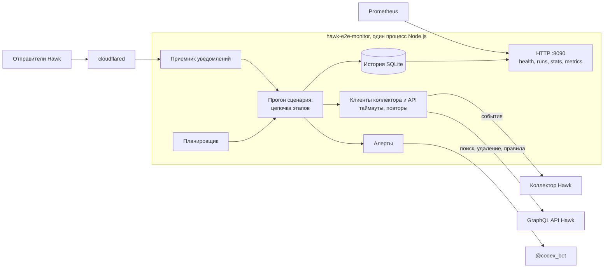
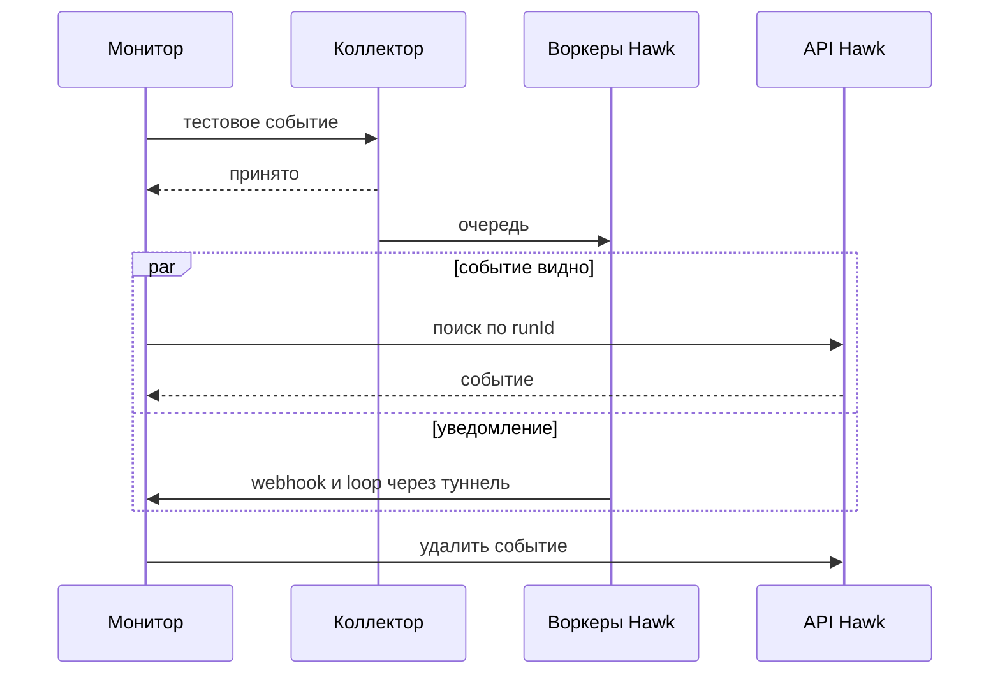

# hawk-e2e-monitor

Синтетический E2E-мониторинг для [Hawk](https://hawk.so). Сервис работает
отдельно от Hawk и по расписанию проходит путь пользователя: отправляет
тестовое событие в коллектор, ждет, пока воркеры его обработают и оно появится
в проекте через API, и проверяет, что Hawk прислал уведомление. О сбое монитор
пишет в Telegram через @codex_bot: какой этап упал, вероятный виновник и время
каждого этапа.

| Сценарий | Что проверяет | По умолчанию |
|---|---|---|
| send-and-receive-event | событие по HTTP или WebSocket принято, обработано, видно с нужными полями, повтор группируется | каждые 10 мин |
| check-notification | Hawk отправил уведомление в webhook и loop, правило с порогом срабатывает на втором событии | каждые 10 мин |
| sourcemaps | релиз с source map сохранен, кадр события указывает на исходный файл и строку | раз в час |
| sentry-envelope | событие в формате Sentry SDK доходит до Hawk | раз в час |
| endpoints-probe | коллектор и API отвечают, а также Garage (при `GARAGE_URL`) и приемник за туннелем (при check-notification или telegram-delivery); событий не шлет | каждые 90 с |
| telegram-delivery | уведомление Hawk доходит до чата в Telegram | выключен, нужен бот |
| new-project | коллектор принимает токен нового проекта | выключен, только для своего Hawk |

## Что нужно от Hawk

> [!IMPORTANT]
> Нужен работающий Hawk (hawk.so или свой) и в нем отдельный проект для монитора.

- Integration token проекта (Garage, Settings, Integrations) и его id из адреса
  страницы `/project/<id>`.
- Email и пароль аккаунта с правами админа воркспейса (Settings, Team, Grant
  Admin). Через него монитор читает и удаляет свои события и ведет свои правила
  уведомлений.
- В проекте нет правила группировки, которое ловит заголовки `[e2e:`.

> [!WARNING]
> Секрет приемника входит в адреса каналов уведомлений, их видят все участники
> воркспейса. Поэтому проект и воркспейс должны быть отдельными.

Hawk шлет уведомления только на публичные адреса, поэтому compose поднимает для
приемника quick tunnel cloudflared (аккаунт Cloudflare не нужен).

## Быстрый старт

Нужны Docker 25+ с Compose 2.24+ (или podman 5 с `podman compose`).

```sh
git clone https://github.com/wFeeL/hawk-e2e-monitor.git
cd hawk-e2e-monitor
cp .env.example .env
```

Заполните в `.env`:

| Переменная | Значение |
|---|---|
| `INSTANCE_ID` | имя монитора: `a-z`, `0-9`, `-`, до 32 символов; входит в заголовок каждого тестового события |
| `HAWK_API_URL` | для hawk.so `https://api.hawk.so/graphql` |
| `HAWK_COLLECTOR_URL` | для hawk.so пусто (адрес берется из токена) |
| `HAWK_PROJECT_ID`, `HAWK_INTEGRATION_TOKEN` | проект и его токен |
| `HAWK_EMAIL`, `HAWK_PASSWORD` | админ воркспейса |
| `RECEIVER_SECRET`, `RUN_TOKEN` | случайные строки от 32 символов: `openssl rand -hex 24` |
| `ALERT_NOTIFY_URL` | адрес от @codex_bot для алертов, см. [Алерты](#алерты) |

Значения с `$` берите в одинарные кавычки. Запуск:

```sh
docker compose up -d --build
docker compose ps
```

Через ~15 с monitor станет healthy, и начнутся прогоны. При ошибке в
конфигурации монитор не стартует и называет переменную в
`docker compose logs monitor`. После правки `.env` нужен `docker compose up -d`,
`restart` новые значения не подхватит.

Монитор занимает на хосте порт `127.0.0.1:8090`; если он занят, задайте в `.env`
`MONITOR_INTERNAL_PORT`. Свой Hawk на том же хосте в Docker на Linux должен
слушать адрес моста docker: `host.docker.internal` ведет туда, и Hawk,
опубликованный только на `127.0.0.1`, из контейнера недоступен.

Команды монитора удобно звать через alias (с podman вместо `docker compose`
пишите `podman compose`):

```sh
alias hem='docker compose exec monitor node dist/main.js'
hem run
hem run check-notification
hem history --limit 10
hem history --stats
```

`hem run` просит работающий монитор сразу прогнать все включенные сценарии
(или названные) и печатает строку на каждый. Вручную сценарий можно запускать
раз в минуту. Код выхода 0, если все прогоны `ok`, 1, если хотя бы один не
прошел, 2, если монитор не удалось спросить. Строки endpoints-probe в общей
истории скрыты, их показывает `hem history --scenario endpoints-probe`.

## Проверить, что монитор ловит сбои

Для учений нужны заполненный `ALERT_NOTIFY_URL` и, чтобы видеть графики,
профиль `observability` (см. [Метрики](#метрики-grafana-и-heartbeat)). В
Grafana смотрите панели «Status by scenario» и «Failures by stage and class».

**Пропал путь уведомлений.** Гасим туннель:

```sh
docker compose stop tunnel
hem run check-notification
```

Прогон падает на `notification_setup` с `tunnel_unavailable`, в Telegram
приходит FAILED с этапом, классом и виновником, в Grafana сценарий краснеет.
Без ручного запуска endpoints-probe покажет сбой в течение 90 с (этап
`receiver_availability` в `hem history --scenario endpoints-probe`), а алерт
пришлет после трех красных проб подряд, через 3-4,5 мин. Чиним:

```sh
docker compose start tunnel
hem run check-notification
```

У туннеля новый адрес, монитор сам переводит на него правила. Второй ручной
запуск монитор примет через минуту после первого (раньше ответит
`skipped: manual run limit`), за это же время новый адрес появится в DNS. Если
прогон снова упал, повторите еще через минуту. После успешного прогона приходит
RECOVERED.

**Коллектор Hawk недоступен.** Временно поставьте в `.env`
`HAWK_COLLECTOR_URL=http://127.0.0.1:59999` (там никто не слушает) и выполните:

```sh
docker compose up -d
hem run send-and-receive-event
```

Перед `hem run` дождитесь `healthy` в `docker compose ps`. Прогон падает на
`collector_availability` с `collector_unavailable` и виновником `hawk`, так же
как при настоящем падении коллектора. Верните прежнее
значение (для hawk.so пустое), снова `docker compose up -d` и `hem run`, придет
RECOVERED.

Остановленные воркеры и рестарты коллектора можно устроить только на своем
Hawk: монитор работает с ним так же, достаточно поменять адреса в `.env`.

## Архитектура



Монитор работает с Hawk только через публичные интерфейсы: коллектор, GraphQL
API и каналы уведомлений. Поэтому одна сборка работает и с hawk.so, и со своим
Hawk.

### Один прогон check-notification



Каждый этап имеет свой таймаут, пишет длительность и детали и либо проходит,
либо завершает прогон с классом ошибки:

| Этап | Проверка |
|---|---|
| `collector_availability`, `api_availability` | коллектор отвечает и отклоняет несуществующий токен; вход в API, токен монитора принадлежит проекту, квота есть |
| `receiver_availability`, `garage_availability` | только endpoints-probe: приемник отвечает через туннель, Garage открывается |
| `notification_setup` | приемник отвечает через туннель, правила уведомлений на месте |
| `collector_accept` | коллектор принял событие |
| `event_visible` | событие найдено в API с ожидаемыми полями |
| `notification_formed` | пришли webhook и loop именно про это событие |
| `event_repeated`, `threshold_formed` | на повторных прогонах: второе событие сгруппировано, сработал порог |
| `cleanup` | событие удалено |

Обработку события и уведомление монитор ждет по условию (опрос API с растущим
шагом, приход webhook), а не заданное время. Фиксированных пауз две, и в обеих
наблюдать нечего: `LATE_DUPLICATE_WAIT_MS` (5 с) перед очисткой ловит позднюю
копию события, `RULE_CACHE_WARMUP_MS` (65 с) после смены правила пережидает кеш
правил Hawk. Повторяются только безопасные запросы: событие, которое коллектор
мог получить, второй раз не отправляется.

**Изоляция.** Заголовок события `[e2e:<INSTANCE_ID>] <runId> <scenario>`, у
каждого прогона свой случайный `runId`, поэтому прогоны не видят чужих событий,
а мониторы с разными `INSTANCE_ID` уживаются в одном проекте. Очистка удаляет
только свое событие, остатки прерванных прогонов раз в час убирает уборка.
Правила уведомлений с фильтром `[e2e:<INSTANCE_ID>]` монитор считает своими и
заводит сам. Hawk кэширует правила около минуты, поэтому прогон, изменивший
фильтры правила, один раз пропускает проверку уведомления.

**Ошибки.** Упавший прогон получает один из 59 классов (`collector_unavailable`,
`event_not_found`, `notification_timeout` и т. д.), понятное сообщение и
виновника: `hawk`, `monitor`, `config` или `network`. Секреты в результатах
замаскированы.

**Хранение.** История и состояние алертов лежат в SQLite (том `monitor-data`)
и переживают рестарты, расписание продолжается с того же места.

<details>
<summary>Структура кода</summary>

| Каталог | Содержимое |
|---|---|
| `src/config` | переменные окружения, проверка zod при старте |
| `src/clients` | клиенты коллектора, API, Telegram, Garage, @codex_bot |
| `src/engine` | этапы, дедлайны, опрос, результаты |
| `src/scenarios` | каталог на сценарий, общие этапы в `shared` |
| `src/notifications`, `src/receiver` | правила уведомлений и приемник |
| `src/scheduler`, `src/serve` | расписание и долгоживущий процесс |
| `src/storage` | история и lease в SQLite |
| `src/alerting`, `src/heartbeat`, `src/metrics` | алерты, heartbeat, метрики |
| `src/errors` | классы ошибок, сообщения, маскирование |
| `src/commands`, `src/cli.ts`, `src/main.ts` | команды `serve`, `run`, `check`, `provision`, `history` |
| `test/` | юнит-тесты против фейкового Hawk, `test/e2e` против живого |

Зависимости в рантайме: `zod` и `prom-client`, остальное из Node.js 26.

</details>

## Постоянная работа

Образ по умолчанию запускает `serve`: расписание, история, алерты, HTTP на
`127.0.0.1:8090`.

**Периоды.** Проверки идут слоями. endpoints-probe каждые 90 с проверяет, что
коллектор, API и туннель живы: красная проба видна в истории и Grafana в течение
90 с, алерт приходит после трех неудач подряд, через 3-4,5 мин. Полный путь события и уведомлений идет
раз в 10 мин: он отправляет событие и ждет обработки, поэтому чаще его гонять
дорого. Периоды меняются в `CHECK_INTERVAL_MS`, `PROBE_INTERVAL_MS` и
соседних переменных.

| Путь | Ответ |
|---|---|
| `GET /healthz` | 200, пока работают планировщик и база и ни один сценарий не завис |
| `GET /readyz` | 200, пока открыт приемник и алерты доставляются |
| `GET /runs`, `GET /runs/<runId>` | последние прогоны, полный результат прогона |
| `GET /stats` | доля успешных, перцентили задержки, средние длительности этапов |
| `GET /metrics` | метрики Prometheus |
| `POST /runs/<scenario>` | ручной запуск с `Authorization: Bearer $RUN_TOKEN`, его использует `hem run` |

### Алерты

Отправьте @codex_bot `/notify_start` в личке или в отдельной группе и
запишите адрес из ответа в `ALERT_NOTIFY_URL`. Монитор пишет, когда сценарий
начал падать (FAILED), когда сменилась причина (STILL FAILING), когда он
восстановился (RECOVERED) и когда прогон прошел с отклонениями (DEGRADED:
пришел один канал уведомлений, квоты меньше 10% и т. п.). Повторные падения с
той же причиной новых сообщений не дают. Недоставленный алерт монитор
повторяет до 24 часов.

### Метрики, Grafana и heartbeat

`GET /metrics` отдает прогоны и падения по сценарию, этапу, классу и
виновнику, длительности этапов, задержки события и уведомления. Профиль
`observability` добавляет Prometheus (`127.0.0.1:9090`) и Grafana
(`127.0.0.1:3000`) с готовым дашбордом и правилами алертов. Сначала задайте
пароль, без него Grafana не стартует:

```sh
cp grafana.env.example .env.grafana
```

В `.env.grafana` впишите `GF_SECURITY_ADMIN_PASSWORD`, затем:

```sh
docker compose --profile observability up -d
```

Правила Prometheus только вычисляются и видны на `127.0.0.1:9090/alerts`:
Alertmanager в compose нет, в Telegram пишет сам монитор. Занятые порты хоста
меняются в `.env` (`PROMETHEUS_PORT`, `GRAFANA_PORT`). Если Prometheus или
Grafana не читают свои файлы (клон сделан с umask без чтения для остальных),
выполните `chmod -R a+rX deploy`. Останавливать стек с тем же профилем:
`docker compose --profile observability down`.

Heartbeat ловит случай, когда остановился сам монитор: задайте в
`HEARTBEAT_URL` адрес пинга внешнего сервиса (Cronitor, healthchecks.io).
Монитор пингует его раз в минуту, пока здоров; в сервисе настройте тревогу
после ~15 минут тишины.

### Сбои и рестарты

- Рестарт Hawk виден как упавшие прогоны с этапом и классом, после него
  приходит RECOVERED.
- Прогон, прерванный рестартом монитора, записывается как `monitor_restarted`
  и сбоем Hawk не считается.
- Зависший прогон отменяется сторожевым таймером (`run_hung`), после трех
  подряд контейнер перезапускается.
- Контейнер tunnel, который остался `unhealthy` (cloudflared жив, но без
  связи), Docker сам не перезапускает: `docker compose restart tunnel`.

Прогон шлет одно событие (два при повторе), ~5000 в месяц на сценарий; монитор
их удаляет, так что квоту они почти не тратят.

## telegram-delivery

Проверяет, что уведомление Hawk доходит до чата Telegram. Монитор заводит
правило с двумя каналами: Telegram через @codex_bot и контрольный webhook на
свой приемник. Свой бот читает тестовую группу и ждет сообщение @codex_bot с
заголовком прогона. Если webhook пришел, а сообщения нет, монитор сам шлет
пробу через @codex_bot: дошла, значит, не доставил воркер Hawk
(`telegram_not_delivered`), не дошла, значит, сломан @codex_bot или адрес
(`telegram_bot_unavailable`).

Настройка:

1. @BotFather: `/newbot`, затем в настройках бота включите Bot-to-Bot
   Communication Mode и выключите Group Privacy (`/setprivacy`, Disable). Без
   этого бот не видит сообщений @codex_bot.
2. Создайте группу только для этой проверки, добавьте @codex_bot и своего бота,
   сделайте своего бота администратором.
3. Только после этого отправьте в группе `/notify_start`: если группа при
   выдаче прав стала супергруппой, у нее сменился id, и старая ссылка ведет в
   никуда.
4. Узнайте id группы: в Bot API он отрицательный (`-100…` или `-…`), а
   клиенты Telegram показывают его без минуса. Надежно так: напишите в группу
   любое сообщение и выполните
   `curl -s "https://api.telegram.org/bot<токен>/getUpdates" | jq '.result[].message.chat.id'`.
5. В `.env`: `TELEGRAM_BOT_TOKEN`, `TELEGRAM_NOTIFY_URL` (ссылка из шага 3),
   `TELEGRAM_CHAT_ID` (с минусом), добавьте `telegram-delivery` в `SCENARIOS`,
   затем `docker compose up -d`.
6. Проверьте цепочку без монитора: `set -a && . ./.env && set +a`, затем
   `curl -X POST "$TELEGRAM_NOTIFY_URL" -d "message=test"` должен дать `OK!` и
   сообщение в группе. Потом `hem run telegram-delivery`.

Алерты (`ALERT_NOTIFY_URL`) держите в другом чате: тестовую группу монитор
читает. Токен бота читает только один процесс, не делите бота между
мониторами.

## Запуск без Docker

Нужны Node.js 26 и `.env`, как в быстром старте:

```sh
npm ci
npm run build
node --env-file-if-exists=.env dist/main.js check send-and-receive-event
```

`check` печатает JSON результата, код выхода 0 при успехе; опции `--transport
http|ws` и `--repeat`. Для check-notification поднимите
`cloudflared tunnel --no-autoupdate --protocol http2 --url http://127.0.0.1:8091 --metrics 127.0.0.1:20241`
и задайте `TUNNEL_METRICS_URL=http://127.0.0.1:20241`. Рядом с Docker-монитором
берите другой `INSTANCE_ID`, иначе два монитора перепишут друг другу правила.
Тесты: `npm test` (без сети) и `E2E_HAWK=1 npm run test:e2e` (против Hawk из
`.env`, после `set -a && . ./.env && set +a`). e2e-набору нужны тот же туннель с
`TUNNEL_METRICS_URL` и свой `INSTANCE_ID`, как для `check`.

## Настройка

Все настройки берутся из переменных окружения, полный список с умолчаниями в
`.env.example`. Конфигурация проверяется при старте, включая связи между
значениями. В compose порты, `TUNNEL_METRICS_URL` и `DATABASE_PATH` заданы в
`compose.yaml`.

| Группа | Переменные |
|---|---|
| Hawk | `INSTANCE_ID`, `HAWK_API_URL`, `HAWK_COLLECTOR_URL`, `HAWK_PROJECT_ID`, `HAWK_INTEGRATION_TOKEN`, `HAWK_EMAIL`, `HAWK_PASSWORD` |
| Расписание | `SCENARIOS`, `CHECK_INTERVAL_MS`, `PROBE_INTERVAL_MS`, `SOURCEMAPS_INTERVAL_MS`, `SENTRY_ENVELOPE_INTERVAL_MS`, `TELEGRAM_DELIVERY_INTERVAL_MS` |
| Таймауты и повторы | `HTTP_TIMEOUT_MS`, `RUN_TIMEOUT_MS`, `*_TIMEOUT_MS` этапов, `RETRY_ATTEMPTS`, `RETRY_DELAYS_MS` |
| Уведомления | `RECEIVER_SECRET`, `PUBLIC_BASE_URL` или `TUNNEL_METRICS_URL`, `NOTIFY_LOOP` |
| Алерты и ручной запуск | `ALERT_NOTIFY_URL`, `ALERT_AFTER_FAILURES`, `PROBE_ALERT_AFTER_FAILURES`, `RUN_TOKEN` |
| Наблюдаемость | `HEARTBEAT_URL`, `GARAGE_URL` |
| Telegram | `TELEGRAM_*`, см. [telegram-delivery](#telegram-delivery) |

**Детали сценариев.** send-and-receive-event перед очисткой перечитывает
счетчик и ловит позднюю копию (`duplicate_event`). check-notification держит
второе правило с порогом и на повторных прогонах (`REPEAT_EVERY_N_RUNS`) ждет
ровно один webhook порога после повтора. sourcemaps оставляет релизы
`e2e-<INSTANCE_ID>-<runId>`: удалить их API Hawk не позволяет. new-project
создает и удаляет проект, только для своего Hawk.

## О тестовом задании

Репозиторий сделан как тестовое задание для CodeX.

Проверено:

- юнит-тесты против фейкового Hawk на случайных портах и с фейковыми часами;
- все сценарии против локального Hawk, собранного из репозиториев CodeX, в
  том числе с остановленными воркерами, рестартами коллектора и API, убитым
  монитором;
- против hawk.so: все сценарии, кроме new-project; compose в podman 5.7 и
  Docker Desktop на macOS.

Ограничения:

- Нужен доступ к Hawk: отдельный проект, его токен и админ воркспейса, см.
  [Что нужно от Hawk](#что-нужно-от-hawk).
- Таймауты фиксированные, пороги деградации по собранным длительностям сервис
  не считает.
- Монитор видит, что @codex_bot принял алерт, но не то, что он дошел до чата.
- Quick tunnel держит одно соединение с Cloudflare (TCP 443). Сети, которые
  рвут долгие соединения (некоторые VPN), дают окна с ответом 530: монитор
  пережидает их при проверке приемника, а пропавшее за время переподключения
  уведомление помечает `tunnel_reconnected` (виновник `network`, хотя мог
  ошибиться и Hawk). Выход: исключить cloudflared из VPN или задать постоянный
  адрес в `PUBLIC_BASE_URL`.
- telegram-delivery зависит от Bot-to-Bot Communication Mode (Telegram Bot API
  10.0).

TODO:

- [x] send-and-receive-event, check-notification
- [x] постоянная работа: расписание, история, алерты, compose
- [x] наблюдаемость: метрики, Grafana, heartbeat, ручной запуск, endpoints-probe
- [x] доставка в Telegram, правило с порогом, source maps, Sentry, новый проект
- [ ] пороги деградации по собранным длительностям этапов
- [ ] общий цикл шагов для check-notification (сейчас он повторяет `runSteps`)
