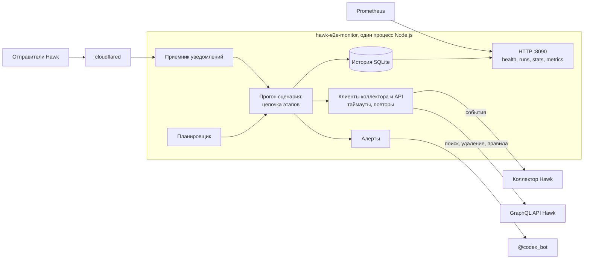

# hawk-e2e-monitor

Синтетический E2E-мониторинг для [Hawk](https://hawk.so). Нужен тем, кто держит
свой Hawk или зависит от hawk.so и хочет узнавать о поломке раньше
пользователей. Монитор ведет себя как обычный пользователь: по расписанию
отправляет тестовые события и проверяет, что Hawk их принял, обработал и
разослал уведомления. Каждый сценарий из таблицы ниже проверяет один
пользовательский путь. О сбое монитор пишет в Telegram через @codex_bot (бот
команды CodeX, которая делает Hawk): какой этап упал, вероятный виновник и
время каждого этапа.

| Сценарий | Что проверяет | По умолчанию |
|---|---|---|
| send-and-receive-event | событие по HTTP или WebSocket принято, обработано, видно с нужными полями; повтор группируется (два прогона подряд раз в 2 часа) | каждые 10 мин |
| check-notification | Hawk отправил уведомление в webhook и loop; правило с порогом срабатывает на втором событии (на тех же двух прогонах раз в 2 часа) | каждые 10 мин |
| sourcemaps | релиз с source map сохранен, кадр события указывает на исходный файл и строку | раз в час |
| sentry-envelope | событие в формате Sentry SDK доходит до Hawk | раз в час |
| endpoints-probe | коллектор и API отвечают, а также Garage (при `GARAGE_URL`) и приемник за туннелем (при check-notification или telegram-delivery); событий не шлет | каждые 90 с |
| telegram-delivery | уведомление Hawk доходит до чата в Telegram | выключен, нужен бот |
| new-project | коллектор принимает токен нового проекта | выключен, только для своего Hawk |

Garage: веб-интерфейс Hawk. Loop: мессенджер, один из каналов уведомлений Hawk.

## Возможности

- Проверяет полный путь события: прием коллектором по HTTP и WebSocket,
  обработку воркерами, появление в проекте с нужными полями, группировку повтора.
- Проверяет уведомления: webhook, loop, правило с порогом и доставку в Telegram.
- Называет место сбоя: этап, один из 58 классов ошибки и вероятного виновника
  (Hawk, монитор, конфигурация или сеть).
- Пишет в Telegram о сбое, смене причины и восстановлении.
- Хранит историю прогонов с длительностью каждого этапа, считает долю успешных
  и задержки.
- Отдает метрики Prometheus; в комплекте дашборд Grafana, правила и heartbeat.
- Переживает рестарты Hawk и свои, убирает за собой тестовые события,
  запускается вручную одной командой.

<p>
  
  
</p>

## Что нужно от Hawk

> [!IMPORTANT]
> Нужен работающий Hawk (hawk.so или свой) и в нем отдельный проект для монитора.

- Integration token проекта (Garage, Settings, Integrations) и его id из адреса
  страницы `/project/<id>`.
- Email и пароль аккаунта с правами админа воркспейса (Settings, Team, Grant
  Admin). Через него монитор читает и удаляет свои события и ведет свои правила
  уведомлений.
- В проекте нет правила группировки, которое ловит заголовки `[e2e:`.

> [!WARNING]
> Монитор принимает уведомления Hawk на свой HTTP-адрес (приемник). В этот
> адрес входит секрет `RECEIVER_SECRET`, а адреса каналов видят все участники
> воркспейса. Поэтому заведите для монитора отдельные воркспейс и проект.

Hawk шлет уведомления только на публичные адреса, поэтому compose поднимает для
приемника quick tunnel cloudflared (аккаунт Cloudflare не нужен). Для
постоянной работы надежнее свой https-адрес в `PUBLIC_BASE_URL`: у quick tunnel
нет гарантий доступности.

Если ваш Hawk работает в Docker на том же Linux-хосте, указывайте его в `.env`
как `host.docker.internal`. Это имя ведет на адрес моста docker, поэтому порты
Hawk должны быть опубликованы на нем или на `0.0.0.0`. До Hawk, опубликованного
только на `127.0.0.1`, контейнер монитора не достанет.

## Быстрый старт

Нужны Docker 25+ с Compose 2.24+ (или podman 5 с `podman compose`).

```sh
git clone https://github.com/wFeeL/hawk-e2e-monitor.git
cd hawk-e2e-monitor
cp .env.example .env
```

Заполните в `.env`:

| Переменная | Значение |
|---|---|
| `INSTANCE_ID` | имя монитора: `a-z`, `0-9`, `-`, до 32 символов, не больше 12 цифр и без имени сценария внутри; входит в заголовок каждого тестового события |
| `HAWK_API_URL` | для hawk.so `https://api.hawk.so/graphql` |
| `HAWK_COLLECTOR_URL` | для hawk.so пусто (адрес берется из токена) |
| `HAWK_PROJECT_ID`, `HAWK_INTEGRATION_TOKEN` | проект и его токен |
| `HAWK_EMAIL`, `HAWK_PASSWORD` | админ воркспейса |
| `RECEIVER_SECRET`, `RUN_TOKEN` | случайные строки от 32 символов: `openssl rand -hex 24` |
| `ALERT_NOTIFY_URL` | адрес от @codex_bot для алертов, см. [Алерты](#алерты) |

Обязательны `INSTANCE_ID`, `HAWK_API_URL`, `HAWK_PROJECT_ID`,
`HAWK_INTEGRATION_TOKEN`, `HAWK_EMAIL`, `HAWK_PASSWORD` и `RECEIVER_SECRET`. Без
`RUN_TOKEN` не работает `hem run`, без `ALERT_NOTIFY_URL` алерты остаются в
логе. Значение с любым символом кроме букв, цифр и `-_./:@,` берите в `.env` в
одинарные кавычки: Compose, Node и шелл читают файл по-разному.

Запуск:

```sh
docker compose up -d --build
docker compose ps
```

Через минуту `docker compose ps` должен показать `monitor` и `tunnel` в
состоянии `healthy`. Если `monitor` перезапускается, причина в логе:
`docker compose logs --tail 50 monitor`. Ошибка в `.env` выглядит как
`Invalid configuration:` со списком переменных. Первые результаты появятся через
2-3 минуты: `hem history --limit 5` (алиас `hem` описан ниже).

Монитор занимает на хосте порт `127.0.0.1:8090`; если он занят, задайте в `.env`
`MONITOR_INTERNAL_PORT`. Сам образ слушает `0.0.0.0`: при `docker run -p
8090:8090` адреса `/runs`, `/stats` и `/metrics` без авторизации станут доступны
всем.

## Команды

Команды монитора удобно звать через alias (с podman вместо `docker compose`
пишите `podman compose`):

```sh
alias hem='docker compose exec monitor node dist/main.js'
hem run
hem run check-notification
hem history --limit 10
hem history --stats
```

`hem run` просит работающий монитор сразу прогнать все включенные сценарии
(или названные) и печатает строку на каждый:

```text
send-and-receive-event  ok  5.7 s
check-notification      ok  5.2 s
sourcemaps              ok  6.2 s
sentry-envelope         ok  5.7 s
endpoints-probe         ok  33 ms
```

`hem history` печатает последние прогоны таблицей (`--json` для машинного
вывода), `--stats` долю успешных за 24 часа и 7 дней. `hem --help` показывает
все команды. Код выхода 0 значит успех, 1 упавшую проверку, 2 ошибку
конфигурации.

## Архитектура



Монитор работает с Hawk только через публичные интерфейсы: коллектор, GraphQL
API и каналы уведомлений. Поэтому одна сборка работает и с hawk.so, и со своим
Hawk.

Прогон состоит из этапов, у каждого свой таймаут:

| Этап | Проверка |
|---|---|
| `collector_availability`, `api_availability` | коллектор отвечает и отклоняет несуществующий токен; вход в API, токен принадлежит проекту, квота есть |
| `receiver_availability`, `garage_availability` | только endpoints-probe: приемник отвечает через туннель, Garage открывается |
| `notification_setup` | приемник отвечает через туннель, правила уведомлений на месте |
| `collector_accept` | коллектор принял событие |
| `event_visible` | событие найдено в API с ожидаемыми полями |
| `notification_formed` | пришли webhook и loop именно про это событие; если пришел один канал, прогон проходит с DEGRADED |
| `event_repeated`, `threshold_formed` | на повторных прогонах: второе событие сгруппировано, сработал порог |
| `cleanup` | событие удалено |

Упавший прогон получает один из 58 классов ошибки (`collector_unavailable`,
`event_not_found`, `notification_timeout` и т. д.), понятное сообщение и
виновника: `hawk`, `monitor`, `config` или `network`. Секреты в результатах
замаскированы. Событие, которое коллектор мог получить, второй раз не
отправляется.

Заголовок события `[e2e:<INSTANCE_ID>] <runId> <scenario>`, поэтому прогоны не
видят чужих событий, а мониторы с разными `INSTANCE_ID` уживаются в одном
проекте. Очистка удаляет только свое событие, остатки прерванных прогонов раз в
час убирает уборка. История лежит в SQLite (том `monitor-data`) 30 дней и
переживает рестарты.

<details>
<summary>Структура кода</summary>

| Каталог | Содержимое |
|---|---|
| `src/config` | переменные окружения, проверка zod при старте |
| `src/clients` | клиенты коллектора, API, Telegram, Garage, @codex_bot |
| `src/engine` | этапы, дедлайны, опрос, результаты |
| `src/scenarios` | каталог на сценарий, общие этапы в `shared` |
| `src/notifications`, `src/receiver` | правила уведомлений и приемник |
| `src/scheduler`, `src/serve` | расписание и долгоживущий процесс |
| `src/storage` | история и lease в SQLite |
| `src/alerting`, `src/heartbeat`, `src/metrics` | алерты, heartbeat, метрики |
| `src/errors` | классы ошибок, сообщения, маскирование |
| `src/commands`, `src/cli.ts`, `src/main.ts` | команды `serve`, `run`, `check`, `provision`, `history` |
| `test/` | юнит-тесты против фейкового Hawk, `test/e2e` против живого |

Зависимости в рантайме: `zod` и `prom-client`, остальное из Node.js 26.

</details>

## Постоянная работа

Образ по умолчанию запускает `serve`: расписание, история, алерты, HTTP на
`127.0.0.1:8090` (`/healthz`, `/readyz`, `/runs`, `/stats`, `/metrics`;
`POST /runs/<scenario>` с `RUN_TOKEN` использует `hem run`).

endpoints-probe каждые 90 с проверяет, что коллектор, API и туннель живы, и
шлет алерт после трех неудач подряд, через 3-4,5 мин. Полный путь события и
уведомлений идет раз в 10 мин. Периоды меняются в `CHECK_INTERVAL_MS`,
`PROBE_INTERVAL_MS` и соседних переменных.

### Алерты

Отправьте @codex_bot `/notify_start` в личке или в отдельной группе и
запишите адрес из ответа в `ALERT_NOTIFY_URL` (он не должен совпадать с
`TELEGRAM_NOTIFY_URL`). Монитор пишет, когда сценарий начал падать (FAILED),
когда сменилась причина (STILL FAILING), когда он восстановился (RECOVERED) и
когда прогон прошел с отклонениями (DEGRADED). RECOVERED приходит, когда
успешные прогоны прошли все этапы, на которых сценарий падал. Если недоступен
коллектор или API, FAILED приходит один на все сценарии. Недоставленный алерт
монитор повторяет до 24 часов.

### Метрики, Grafana и heartbeat

Профиль `observability` добавляет Prometheus (`127.0.0.1:9090`) и Grafana с
готовым дашбордом и правилами. Сначала задайте пароль Grafana:

```sh
cp grafana.env.example .env.grafana   # впишите GF_SECURITY_ADMIN_PASSWORD
docker compose --profile observability up -d
```

Дашборд: `http://127.0.0.1:3000/d/hawk-e2e-monitor`, логин `admin`. Панелям с
подсчетом сбоев нужен час истории, статус сценариев виден сразу. Правила
Prometheus только вычисляются (`127.0.0.1:9090/alerts`), в Telegram пишет сам
монитор. Занятые порты меняются в `.env` (`PROMETHEUS_PORT`, `GRAFANA_PORT`).

Heartbeat ловит случай, когда остановился сам монитор: задайте в
`HEARTBEAT_URL` адрес пинга внешнего сервиса (Cronitor, healthchecks.io) и
настройте там тревогу после ~15 минут тишины.

### Сбои и рестарты

- Рестарт Hawk виден как упавшие прогоны с этапом и классом, после него
  приходит RECOVERED. Остановка самого монитора сбоем Hawk не считается.
- Зависший прогон отменяется сторожевым таймером (`run_hung`), после трех
  подряд монитор завершается с кодом 1 и Docker его перезапускает. Туннель в
  состоянии `unhealthy` перезапускайте сами: `docker compose restart tunnel`.

### Удаление

`docker compose --profile observability down -v` убирает контейнеры и тома
вместе с историей. В проекте Hawk останутся правила уведомлений с
фильтром `[e2e:<INSTANCE_ID>]` и релизы `e2e-<INSTANCE_ID>-…`. Правила удалите в
настройках проекта или удалите проект целиком.

## Имитация сбоев

Нужны заполненный `ALERT_NOTIFY_URL` и, чтобы видеть графики, профиль
`observability` (см. [Метрики](#метрики-grafana-и-heartbeat) выше). В Grafana
смотрите панели «Status by scenario» и «Failures by stage and class». Вторая
показывает первый сбой каждого вида только через час истории, до этого на ней 0.

**Останавливаем туннель:**

```sh
docker compose stop tunnel
hem run check-notification
```

Что ожидается:

- прогон падает на этапе `notification_setup` с классом `tunnel_unavailable`;
- в Telegram приходит FAILED с этапом, классом и виновником;
- в Grafana на панели «Status by scenario» сценарий краснеет;
- без ручного запуска сбой заметит endpoints-probe: красная проба появится в
  течение 90 с (этап `receiver_availability` в
  `hem history --scenario endpoints-probe` и на панели «Status by scenario»),
  алерт придет после трех красных проб подряд, через 3-4,5 мин.

Чиним:

```sh
docker compose start tunnel
hem run check-notification
```

У туннеля новый адрес, монитор сам переводит на него правила. Второй ручной
запуск монитор примет через минуту после первого (раньше ответит
`skipped: manual run limit`), за это же время новый адрес появится в DNS. Если
прогон снова упал, повторите еще через минуту. После успешного прогона приходит
RECOVERED.

**Имитируем недоступный коллектор Hawk.** Временно поставьте в `.env`
`HAWK_COLLECTOR_URL=http://127.0.0.1:59999` (там никто не слушает), затем:

```sh
docker compose up -d
hem run send-and-receive-event
```

Что ожидается:

- прогон падает на этапе `collector_availability` с классом
  `collector_unavailable` и виновником `hawk`, так же как при настоящем падении
  коллектора;
- в Telegram приходит FAILED.

Если до этого endpoints-probe успел сообщить о том же сбое коллектора (после
трех красных проб), FAILED от `send-and-receive-event` не придет: о недоступности
коллектора и API монитор пишет один раз на все сценарии (см.
[Алерты](#алерты)). Поэтому запускайте `hem run` сразу после смены `.env`.

Верните прежнее значение (для hawk.so пустое), снова `docker compose up -d` и
`hem run`: придет RECOVERED (от сценария, который сообщил о сбое).

Остановленные воркеры и рестарты коллектора можно устроить только на своем
Hawk: монитор работает с ним так же, достаточно поменять адреса в `.env`.

## telegram-delivery

Проверяет, что уведомление Hawk доходит до чата Telegram. Монитор заводит
правило с двумя каналами: Telegram через @codex_bot и контрольный webhook на
свой приемник. Свой бот читает тестовую группу и ждет сообщение @codex_bot с
заголовком прогона. Если webhook пришел, а сообщения нет, монитор сам шлет
пробу через @codex_bot: дошла, значит, не доставил воркер Hawk
(`telegram_not_delivered`), не дошла, значит, сломан @codex_bot или адрес
(`telegram_bot_unavailable`).

<details>
<summary>Настройка</summary>

1. @BotFather: `/newbot`, затем в настройках бота включите Bot-to-Bot
   Communication Mode и выключите Group Privacy (`/setprivacy`, Disable). Без
   этого бот не видит сообщений @codex_bot.
2. Создайте группу только для этой проверки, добавьте @codex_bot и своего бота,
   сделайте своего бота администратором.
3. Только после этого отправьте в группе `/notify_start`: если группа при
   выдаче прав стала супергруппой, у нее сменился id, и старая ссылка ведет в
   никуда.
4. Узнайте id группы: в Bot API он отрицательный (`-100…` или `-…`), а
   клиенты Telegram показывают его без минуса. Надежно так: напишите в группу
   любое сообщение и выполните
   `curl -s "https://api.telegram.org/bot<токен>/getUpdates" | jq '.result[].message.chat.id'`.
5. Проверьте цепочку без монитора: `curl -X POST "<ссылка из шага 3>" -d
   "message=test"` должен ответить `OK!`, а в группе появится сообщение.
6. В `.env`: `TELEGRAM_BOT_TOKEN`, `TELEGRAM_NOTIFY_URL` (ссылка из шага 3),
   `TELEGRAM_CHAT_ID` (с минусом), добавьте `telegram-delivery` в `SCENARIOS`.
   Затем `docker compose up -d` и `hem run telegram-delivery`.

</details>

Алерты (`ALERT_NOTIFY_URL`) держите в другом чате: тестовую группу монитор
читает, а совпадение `ALERT_NOTIFY_URL` с `TELEGRAM_NOTIFY_URL` он отвергает при
старте. Токен бота читает только один процесс, не делите бота между
мониторами.

## Запуск без Docker

Нужны Node.js 26 и `.env`, как в быстром старте:

```sh
npm ci
npm run build
node --env-file-if-exists=.env dist/main.js check send-and-receive-event
npm run start:dev   # сервис целиком
```

Для check-notification нужен туннель:
`cloudflared tunnel --no-autoupdate --protocol http2 --url http://127.0.0.1:8091 --metrics 127.0.0.1:20241`
и `TUNNEL_METRICS_URL=http://127.0.0.1:20241`. Рядом с Docker-монитором берите
другой `INSTANCE_ID`.

### Тесты

```sh
npm test                      # юнит-тесты против фейкового Hawk, без сети
npm run build && npm run test:smoke
E2E_HAWK=1 npm run test:e2e   # против Hawk из .env, нужен тот же туннель
```

## Настройка

Все настройки берутся из переменных окружения, полный список с умолчаниями и
пояснениями в `.env.example`. Конфигурация проверяется при старте, ошибки
печатаются одним списком. Настройка telegram-delivery описана
[выше](#telegram-delivery).

## Лицензия

[MIT](LICENSE)
