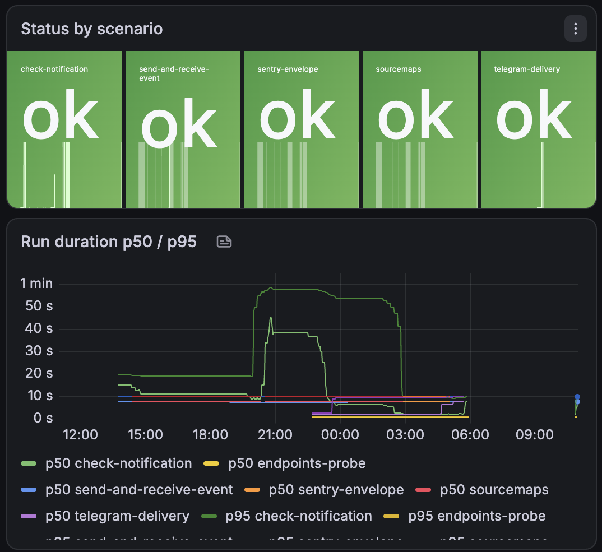
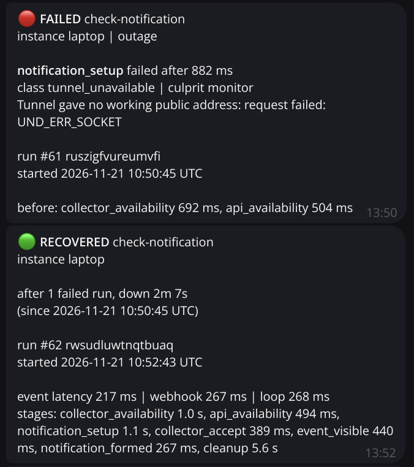
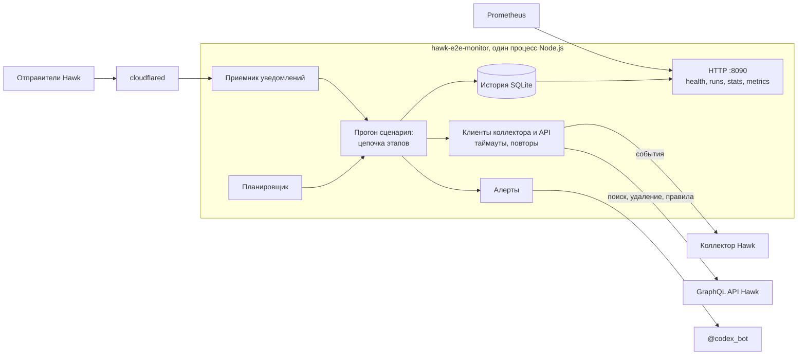
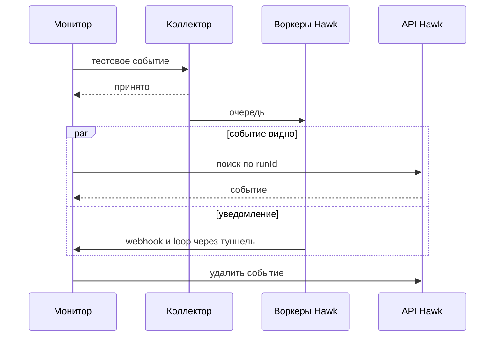

# hawk-e2e-monitor

Синтетический E2E-мониторинг для [Hawk](https://hawk.so). Нужен тем, кто держит
свой Hawk или зависит от hawk.so и хочет узнавать о поломке раньше
пользователей. Монитор ведет себя как обычный пользователь: по расписанию
отправляет тестовые события и проверяет, что Hawk их принял, обработал и
разослал уведомления. Каждый сценарий из таблицы ниже проверяет один
пользовательский путь. О сбое монитор пишет в Telegram через @codex_bot (бот
команды CodeX, которая делает Hawk): какой этап упал, вероятный виновник и
время каждого этапа.

| Сценарий | Что проверяет | По умолчанию |
|---|---|---|
| send-and-receive-event | событие по HTTP или WebSocket принято, обработано, видно с нужными полями; повтор группируется (два прогона подряд раз в 2 часа) | каждые 10 мин |
| check-notification | Hawk отправил уведомление в webhook и loop; правило с порогом срабатывает на втором событии (на тех же двух прогонах раз в 2 часа) | каждые 10 мин |
| sourcemaps | релиз с source map сохранен, кадр события указывает на исходный файл и строку | раз в час |
| sentry-envelope | событие в формате Sentry SDK доходит до Hawk | раз в час |
| endpoints-probe | коллектор и API отвечают, а также Garage (при `GARAGE_URL`) и приемник за туннелем (при check-notification или telegram-delivery); событий не шлет | каждые 90 с |
| telegram-delivery | уведомление Hawk доходит до чата в Telegram | выключен, нужен бот |
| new-project | коллектор принимает токен нового проекта | выключен, только для своего Hawk |

Garage: веб-интерфейс Hawk. Loop: мессенджер, один из каналов уведомлений Hawk.

## Возможности

- Проверяет полный путь события: прием коллектором по HTTP и WebSocket,
  обработку воркерами, появление в проекте с нужными полями, группировку повтора.
- Проверяет уведомления: webhook, loop, правило с порогом и доставку в Telegram.
- Называет место сбоя: этап, один из 58 классов ошибки и вероятного виновника
  (Hawk, монитор, конфигурация или сеть).
- Пишет в Telegram о сбое, смене причины и восстановлении.
- Хранит историю прогонов с длительностью каждого этапа, считает долю успешных
  и задержки.
- Отдает метрики Prometheus; в комплекте дашборд Grafana, правила и heartbeat.
- Переживает рестарты Hawk и свои, убирает за собой тестовые события,
  запускается вручную одной командой.

<p>
  
  
</p>

## Что нужно от Hawk

> [!IMPORTANT]
> Нужен работающий Hawk (hawk.so или свой) и в нем отдельный проект для монитора.

- Integration token проекта (Garage, Settings, Integrations) и его id из адреса
  страницы `/project/<id>`.
- Email и пароль аккаунта с правами админа воркспейса (Settings, Team, Grant
  Admin). Через него монитор читает и удаляет свои события и ведет свои правила
  уведомлений.
- В проекте нет правила группировки, которое ловит заголовки `[e2e:`.

> [!WARNING]
> Монитор принимает уведомления Hawk на свой HTTP-адрес (приемник). В этот
> адрес входит секрет `RECEIVER_SECRET`, а адреса каналов видят все участники
> воркспейса. Поэтому заведите для монитора отдельные воркспейс и проект.

Hawk шлет уведомления только на публичные адреса, поэтому compose поднимает для
приемника quick tunnel cloudflared (аккаунт Cloudflare не нужен). Для
постоянной работы надежнее свой https-адрес в `PUBLIC_BASE_URL`: у quick tunnel
нет гарантий доступности.

Если ваш Hawk работает в Docker на том же Linux-хосте, указывайте его в `.env`
как `host.docker.internal`. Это имя ведет на адрес моста docker, поэтому порты
Hawk должны быть опубликованы на нем или на `0.0.0.0`. До Hawk, опубликованного
только на `127.0.0.1`, контейнер монитора не достанет.

Сколько это стоит. С настройками по умолчанию монитор отправляет около 11 500
событий за 30 дней и удаляет их за собой (точное число для вашей конфигурации
он пишет в лог при старте, строка `events sent per 30 days`). Сценарий
sourcemaps оставляет в проекте по одному релизу на прогон, это 24 релиза в
сутки, и удалить их API Hawk не позволяет. Алерты идут через @codex_bot, а
уведомления Hawk приходят через quick tunnel без гарантий.

## Быстрый старт

Нужны Docker 25+ с Compose 2.24+ (или podman 5 с `podman compose`).

```sh
git clone https://github.com/wFeeL/hawk-e2e-monitor.git
cd hawk-e2e-monitor
cp .env.example .env
```

Заполните в `.env`:

| Переменная | Значение |
|---|---|
| `INSTANCE_ID` | имя монитора: `a-z`, `0-9`, `-`, до 32 символов, не больше 12 цифр и без имени сценария внутри; входит в заголовок каждого тестового события |
| `HAWK_API_URL` | для hawk.so `https://api.hawk.so/graphql` |
| `HAWK_COLLECTOR_URL` | для hawk.so пусто (адрес берется из токена) |
| `HAWK_PROJECT_ID`, `HAWK_INTEGRATION_TOKEN` | проект и его токен |
| `HAWK_EMAIL`, `HAWK_PASSWORD` | админ воркспейса |
| `RECEIVER_SECRET`, `RUN_TOKEN` | случайные строки от 32 символов: `openssl rand -hex 24` |
| `ALERT_NOTIFY_URL` | адрес от @codex_bot для алертов, см. [Алерты](#алерты) |

Обязательны `INSTANCE_ID`, `HAWK_API_URL`, `HAWK_PROJECT_ID`,
`HAWK_INTEGRATION_TOKEN`, `HAWK_EMAIL`, `HAWK_PASSWORD` и `RECEIVER_SECRET`. Без
`RUN_TOKEN` не работает `hem run`, без `ALERT_NOTIFY_URL` алерты остаются в логе. Значение с любым символом кроме
букв, цифр и `-_./:@,` берите в `.env` в одинарные кавычки: Compose, Node и шелл
читают файл по-разному.

Запуск:

```sh
docker compose up -d --build
docker compose ps
```

Через минуту `docker compose ps` должен показать `monitor` и `tunnel` в
состоянии `healthy`. Если `monitor` перезапускается, причина в логе:
`docker compose logs --tail 50 monitor`. Ошибка в `.env` выглядит как
`Invalid configuration:` со списком переменных. Первые результаты появятся через
2-3 минуты: `hem history --limit 5` (алиас `hem` описан ниже).

Монитор занимает на хосте порт `127.0.0.1:8090`; если он занят, задайте в `.env`
`MONITOR_INTERNAL_PORT`. Сам образ слушает `0.0.0.0`, а на loopback его сужает
только публикация порта в compose. При `docker run -p 8090:8090` адреса `/runs`,
`/stats` и `/metrics` без авторизации станут доступны всем.

## Команды

Команды монитора удобно звать через alias (с podman вместо `docker compose`
пишите `podman compose`):

```sh
alias hem='docker compose exec monitor node dist/main.js'
hem run
hem run check-notification
hem history --limit 10
hem history --stats
```

`hem --help` печатает список команд, `hem --version` версию. Код выхода 0
значит успех, 1 упавшую проверку, 2 ошибку конфигурации (или, у `run`, монитор,
которого не удалось спросить): по нему обертка отличит сломанный Hawk от
сломанного `.env`.

`hem run` просит работающий монитор сразу прогнать все включенные сценарии
(или названные) и печатает строку на каждый:

```text
send-and-receive-event  ok  5.7 s
check-notification      ok  5.2 s
sourcemaps              ok  6.2 s
sentry-envelope         ok  5.7 s
endpoints-probe         ok  33 ms
```

Вручную каждый сценарий можно запускать раз в минуту (интервал задает
`MANUAL_MIN_INTERVAL_MS`, 0 снимает ограничение); счет идет в памяти монитора,
рестарт его сбрасывает. `hem history` печатает таблицу:

```text
STARTED                   SCENARIO                STATUS  DURATION  STAGE          CLASS
2026-11-21T12:10:00.000Z  check-notification      failed  5204 ms   event_visible  event_not_found
2026-11-21T12:00:00.000Z  send-and-receive-event  ok      5702 ms   -              -
```

С `--json` каждый прогон выводится одной строкой JSON. `--stats` печатает долю
успешных за 24 часа и 7 дней по сценариям, `--scenario <имя>` оставляет один
сценарий. Строки endpoints-probe в общей истории скрыты, их показывает
`hem history --scenario endpoints-probe`. `hem provision [--no-wait]` приводит
правила уведомлений проекта к нужному состоянию и по умолчанию ждет, пока Hawk
их перечитает; монитор делает это и сам.

## Архитектура



Монитор работает с Hawk только через публичные интерфейсы: коллектор, GraphQL
API и каналы уведомлений. Поэтому одна сборка работает и с hawk.so, и со своим
Hawk.

### Один прогон check-notification



Каждый этап имеет свой таймаут, пишет длительность и детали. Он проходит,
пропускается, завершается как `uncertain` (например, неясно, дошло ли событие:
прогон идет дальше и ищет его) или завершает прогон с классом ошибки:

| Этап | Проверка |
|---|---|
| `collector_availability`, `api_availability` | коллектор отвечает и отклоняет несуществующий токен; вход в API, токен монитора принадлежит проекту, квота есть |
| `receiver_availability`, `garage_availability` | только endpoints-probe: приемник отвечает через туннель, Garage открывается |
| `notification_setup` | приемник отвечает через туннель, правила уведомлений на месте |
| `collector_accept` | коллектор принял событие |
| `event_visible` | событие найдено в API с ожидаемыми полями |
| `notification_formed` | пришли webhook и loop именно про это событие; если пришел один канал, прогон проходит с DEGRADED |
| `event_repeated`, `threshold_formed` | на повторных прогонах (раз в 2 часа, см. «Детали сценариев»): второе событие сгруппировано, сработал порог |
| `cleanup` | событие удалено |

Обработку события и уведомление монитор ждет по условию (опрос API с растущим
шагом, приход webhook), а не заданное время. Фиксированных пауз две, и в обеих
наблюдать нечего: `LATE_DUPLICATE_WAIT_MS` (5 с) перед очисткой ловит позднюю
копию события (если прогон уже упал, паузы нет), `RULE_CACHE_WARMUP_MS` (65 с)
после смены правила пережидает кеш правил Hawk. Повторяются только безопасные запросы: событие, которое коллектор
мог получить, второй раз не отправляется.

**Изоляция.** Заголовок события `[e2e:<INSTANCE_ID>] <runId> <scenario>`, у
каждого прогона свой случайный `runId`, поэтому прогоны не видят чужих событий,
а мониторы с разными `INSTANCE_ID` уживаются в одном проекте. Очистка удаляет
только свое событие, остатки прерванных прогонов раз в час убирает уборка.
Правила уведомлений с фильтром `[e2e:<INSTANCE_ID>]` монитор считает своими и
заводит сам. Hawk кэширует правила около минуты, поэтому прогон, изменивший
фильтры правила, один раз пропускает проверку уведомления.

**Ошибки.** Упавший прогон получает один из 58 классов (`collector_unavailable`,
`event_not_found`, `notification_timeout` и т. д.), понятное сообщение и
виновника: `hawk`, `monitor`, `config` или `network`. Класс `accept_uncertain`
в этот счет не входит: он только предупреждение (DEGRADED), прогон при нем идет
дальше. Секреты в результатах замаскированы.

**Хранение.** История и состояние алертов лежат в SQLite (том `monitor-data`)
и переживают рестарты, расписание продолжается с того же места. Прогоны хранятся
`HISTORY_RETENTION_DAYS` (30 дней), строки endpoints-probe `PROBE_RETENTION_DAYS`
(7 дней).

<details>
<summary>Структура кода</summary>

| Каталог | Содержимое |
|---|---|
| `src/config` | переменные окружения, проверка zod при старте |
| `src/clients` | клиенты коллектора, API, Telegram, Garage, @codex_bot |
| `src/engine` | этапы, дедлайны, опрос, результаты |
| `src/scenarios` | каталог на сценарий, общие этапы в `shared` |
| `src/notifications`, `src/receiver` | правила уведомлений и приемник |
| `src/scheduler`, `src/serve` | расписание и долгоживущий процесс |
| `src/storage` | история и lease в SQLite |
| `src/alerting`, `src/heartbeat`, `src/metrics` | алерты, heartbeat, метрики |
| `src/errors` | классы ошибок, сообщения, маскирование |
| `src/commands`, `src/cli.ts`, `src/main.ts` | команды `serve`, `run`, `check`, `provision`, `history` |
| `test/` | юнит-тесты против фейкового Hawk, `test/e2e` против живого |

Зависимости в рантайме: `zod` и `prom-client`, остальное из Node.js 26.

</details>

## Постоянная работа

Образ по умолчанию запускает `serve`: расписание, история, алерты, HTTP на порту
8090 (compose публикует его только на `127.0.0.1`).

**Периоды.** Проверки идут слоями. endpoints-probe каждые 90 с проверяет, что
коллектор, API и туннель живы: красная проба видна в
`hem history --scenario endpoints-probe` и в Grafana в течение 90 с, алерт
приходит после трех неудач подряд, через 3-4,5 мин. Полный путь события и
уведомлений идет раз в 10 мин: он отправляет событие и ждет обработки, поэтому чаще его гонять
дорого. Периоды меняются в `CHECK_INTERVAL_MS`, `PROBE_INTERVAL_MS` и
соседних переменных.

| Путь | Ответ |
|---|---|
| `GET /healthz` | 200, пока работают планировщик и база и ни один сценарий не завис |
| `GET /readyz` | 200, пока открыт приемник и алерты доставляются |
| `GET /runs`, `GET /runs/<runId>` | последние прогоны (`?scenario=&limit=`, не больше 500), полный результат прогона |
| `GET /stats` | доля успешных, перцентили задержки, средние длительности этапов |
| `GET /metrics` | метрики Prometheus |
| `POST /runs/<scenario>` | ручной запуск с `Authorization: Bearer $RUN_TOKEN`, его использует `hem run`; с `?wait=true` ответ приходит после конца прогона |

### Алерты

Отправьте @codex_bot `/notify_start` в личке или в отдельной группе и
запишите адрес из ответа в `ALERT_NOTIFY_URL`. Монитор пишет, когда сценарий
начал падать (FAILED), когда сменилась причина (STILL FAILING), когда он
восстановился (RECOVERED) и когда прогон прошел с отклонениями (DEGRADED:
пришел один канал уведомлений, квоты меньше 10% и т. п.). STILL FAILING идет
только для причины, которую в этом сбое еще не называли: повторное падение с
уже названной причиной нового сообщения не дает.

Успешный прогон снимает только те сбои, через которые сам прошел. Если
WebSocket-прогон упал на `event_visible`, успех по HTTP этот сбой не закрывает,
а сбой этапов `event_repeated` и `threshold_formed` закрывает только прогон с
повтором. RECOVERED приходит, когда закрыты все сбои сценария.

Недоступность коллектора или API монитор объявляет один раз на все сценарии:
если сценарий с интервалом не больше `CHECK_INTERVAL_MS` уже сообщил о таком
сбое, остальные молчат, а RECOVERED придет от того, кто сообщил. Причины вне
этих двух этапов остальные сценарии шлют сами.

Недоставленный алерт монитор повторяет до 24 часов. Если @codex_bot три раза
отклоняет само сообщение, а другое сообщение проходит, отклоняемое отбрасывается
(в логе `alert dropped after rejections`). `ALERT_NOTIFY_URL` не может совпадать
с `TELEGRAM_NOTIFY_URL`: монитор не стартует, чтобы алерты не попадали в
тестовую группу.

### Метрики, Grafana и heartbeat

`GET /metrics` отдает прогоны и падения по сценарию, этапу, классу и
виновнику, длительности этапов, задержки события и уведомления. Профиль
`observability` добавляет Prometheus (`127.0.0.1:9090`) и Grafana
(`127.0.0.1:3000`) с готовым дашбордом и правилами алертов. Сначала задайте
пароль, без него Grafana не стартует:

```sh
cp grafana.env.example .env.grafana
```

В `.env.grafana` впишите `GF_SECURITY_ADMIN_PASSWORD`, затем:

```sh
docker compose --profile observability up -d
```

Grafana откроется на `http://127.0.0.1:3000/d/hawk-e2e-monitor`, логин `admin`,
пароль из `.env.grafana`. Пароль применяется только при первом старте тома
`grafana-data`. Панелям с подсчетом сбоев нужен час истории: до этого первый сбой
каждого вида показывается как 0. Статус сценариев, включая endpoints-probe,
виден сразу.

Правила Prometheus только вычисляются и видны на `127.0.0.1:9090/alerts`:
Alertmanager в compose нет, в Telegram пишет сам монитор. Дашборд и правила
рассчитаны на имя job `monitor` из
`deploy/prometheus/prometheus.yml`. Занятые порты хоста меняются в `.env`
(`PROMETHEUS_PORT`, `GRAFANA_PORT`). Если Prometheus или Grafana не читают свои
файлы (клон сделан с umask без чтения для остальных), выполните
`chmod -R a+rX deploy`. Останавливать стек с тем же профилем:
`docker compose --profile observability down`.

Heartbeat ловит случай, когда остановился сам монитор: задайте в
`HEARTBEAT_URL` адрес пинга внешнего сервиса (Cronitor, healthchecks.io).
Монитор пингует его раз в минуту, пока здоров; в сервисе настройте тревогу
после ~15 минут тишины.

### Сбои и рестарты

- Рестарт Hawk виден как упавшие прогоны с этапом и классом, после него
  приходит RECOVERED.
- Прогон, прерванный остановкой монитора, записывается как `monitor_stopped`,
  а прерванный аварийным выходом как `monitor_restarted` (при следующем старте).
  Сбоем Hawk ни тот ни другой не считается, а прерванный плановый прогон после
  старта запускается заново.
- Зависший прогон отменяется сторожевым таймером (`run_hung`). После трех
  подряд, а также когда сценарий перестал запускаться, монитор завершается с
  кодом 1, и Docker его перезапускает.
- Контейнер tunnel, который остался `unhealthy` (cloudflared жив, но без
  связи), Docker сам не перезапускает: `docker compose restart tunnel`.

### Обновление и удаление

Обновление: `git pull`, затем `docker compose up -d --build`. История в томе
`monitor-data` сохраняется. Схема истории обновляется при старте, и более старая
сборка файл новой версии не откроет: при откате удалите том.

Удаление: `docker compose --profile observability down -v` убирает контейнеры и
тома, вместе с историей. В проекте Hawk останутся правила уведомлений с
фильтром `[e2e:<INSTANCE_ID>]` и релизы `e2e-<INSTANCE_ID>-…`. Правила удалите в
настройках проекта или удалите проект целиком.

## Имитация сбоев

Нужны заполненный `ALERT_NOTIFY_URL` и, чтобы видеть графики, профиль
`observability` (см. [Метрики](#метрики-grafana-и-heartbeat) выше). В Grafana
смотрите панели «Status by scenario» и «Failures by stage and class». Вторая
показывает первый сбой каждого вида только через час истории, до этого на ней 0.

**Останавливаем туннель:**

```sh
docker compose stop tunnel
hem run check-notification
```

Что ожидается:

- прогон падает на этапе `notification_setup` с классом `tunnel_unavailable`;
- в Telegram приходит FAILED с этапом, классом и виновником;
- в Grafana на панели «Status by scenario» сценарий краснеет;
- без ручного запуска сбой заметит endpoints-probe: красная проба появится в
  течение 90 с (этап `receiver_availability` в
  `hem history --scenario endpoints-probe` и на панели «Status by scenario»),
  алерт придет после трех красных проб подряд, через 3-4,5 мин.

Чиним:

```sh
docker compose start tunnel
hem run check-notification
```

У туннеля новый адрес, монитор сам переводит на него правила. Второй ручной
запуск монитор примет через минуту после первого (раньше ответит
`skipped: manual run limit`), за это же время новый адрес появится в DNS. Если
прогон снова упал, повторите еще через минуту. После успешного прогона приходит
RECOVERED.

**Имитируем недоступный коллектор Hawk.** Временно поставьте в `.env`
`HAWK_COLLECTOR_URL=http://127.0.0.1:59999` (там никто не слушает), затем:

```sh
docker compose up -d
hem run send-and-receive-event
```

Что ожидается:

- прогон падает на этапе `collector_availability` с классом
  `collector_unavailable` и виновником `hawk`, так же как при настоящем падении
  коллектора;
- в Telegram приходит FAILED.

Если до этого endpoints-probe успел сообщить о том же сбое коллектора (после
трех красных проб), FAILED от `send-and-receive-event` не придет: о недоступности
коллектора и API монитор пишет один раз на все сценарии (см.
[Алерты](#алерты)). Поэтому запускайте `hem run` сразу после смены `.env`.

Верните прежнее значение (для hawk.so пустое), снова `docker compose up -d` и
`hem run`: придет RECOVERED (от сценария, который сообщил о сбое).

Остановленные воркеры и рестарты коллектора можно устроить только на своем
Hawk: монитор работает с ним так же, достаточно поменять адреса в `.env`.

## telegram-delivery

Проверяет, что уведомление Hawk доходит до чата Telegram. Монитор заводит
правило с двумя каналами: Telegram через @codex_bot и контрольный webhook на
свой приемник. Свой бот читает тестовую группу и ждет сообщение @codex_bot с
заголовком прогона. Если webhook пришел, а сообщения нет, монитор сам шлет
пробу через @codex_bot: дошла, значит, не доставил воркер Hawk
(`telegram_not_delivered`), не дошла, значит, сломан @codex_bot или адрес
(`telegram_bot_unavailable`).

<details>
<summary>Настройка</summary>

1. @BotFather: `/newbot`, затем в настройках бота включите Bot-to-Bot
   Communication Mode и выключите Group Privacy (`/setprivacy`, Disable). Без
   этого бот не видит сообщений @codex_bot.
2. Создайте группу только для этой проверки, добавьте @codex_bot и своего бота,
   сделайте своего бота администратором.
3. Только после этого отправьте в группе `/notify_start`: если группа при
   выдаче прав стала супергруппой, у нее сменился id, и старая ссылка ведет в
   никуда.
4. Узнайте id группы: в Bot API он отрицательный (`-100…` или `-…`), а
   клиенты Telegram показывают его без минуса. Надежно так: напишите в группу
   любое сообщение и выполните
   `curl -s "https://api.telegram.org/bot<токен>/getUpdates" | jq '.result[].message.chat.id'`.
5. Проверьте цепочку без монитора: `curl -X POST "<ссылка из шага 3>" -d
   "message=test"` должен ответить `OK!`, а в группе появится сообщение.
6. В `.env`: `TELEGRAM_BOT_TOKEN`, `TELEGRAM_NOTIFY_URL` (ссылка из шага 3),
   `TELEGRAM_CHAT_ID` (с минусом), добавьте `telegram-delivery` в `SCENARIOS`.
   Затем `docker compose up -d` и `hem run telegram-delivery`.

</details>

Алерты (`ALERT_NOTIFY_URL`) держите в другом чате: тестовую группу монитор
читает, а совпадение `ALERT_NOTIFY_URL` с `TELEGRAM_NOTIFY_URL` он отвергает при
старте. Токен бота читает только один процесс, не делите бота между
мониторами.

## Запуск без Docker

Нужны Node.js 26 и `.env`, как в быстром старте. `cloudflared` нужен только для
check-notification.

```sh
npm ci
npm run build
node --env-file-if-exists=.env dist/main.js check send-and-receive-event
```

`--env-file-if-exists` молча работает и без `.env`: тогда переменные берутся из
окружения, а при их нехватке команда печатает `Invalid configuration:`. `check`
печатает JSON результата. Код выхода 0 при успехе, 1 при упавшей проверке, 2
при ошибке конфигурации. Опции `--sequence <n>`, `--transport http|ws` и
`--repeat` относятся к send-and-receive-event, check-notification и
telegram-delivery, остальные сценарии их отклоняют. Сам сервис запускает
`npm run start:dev`.

Для check-notification поднимите
`cloudflared tunnel --no-autoupdate --protocol http2 --url http://127.0.0.1:8091 --metrics 127.0.0.1:20241`
и задайте `TUNNEL_METRICS_URL=http://127.0.0.1:20241`. Рядом с Docker-монитором
берите другой `INSTANCE_ID`: два монитора с одним именем переписывают друг другу
правила, и в одном из них прогон упадет с `provisioning_conflict`.

### Тесты

`npm test` гоняет юнит-тесты против фейкового Hawk, сеть ему не нужна.
`npm run test:smoke` запускает собранный `dist/main.js` (сначала `npm run
build`). e2e-набор идет против Hawk из `.env` и читает его сам; ему нужны тот же
туннель с `TUNNEL_METRICS_URL` и свой `INSTANCE_ID`, как для `check`. Без
`E2E_HAWK=1` он завершается с ошибкой.

```sh
npm test
npm run test:smoke
E2E_HAWK=1 npm run test:e2e
```

## Настройка

Все настройки берутся из переменных окружения, полный список с умолчаниями в
`.env.example`. Конфигурация проверяется при старте, включая связи между
значениями. Ошибки печатаются списком, команда выходит с кодом 2. В compose
порты, `TUNNEL_METRICS_URL` и `DATABASE_PATH` заданы в `compose.yaml`.

| Группа | Переменные |
|---|---|
| Hawk | `INSTANCE_ID`, `HAWK_API_URL`, `HAWK_COLLECTOR_URL`, `HAWK_PROJECT_ID`, `HAWK_INTEGRATION_TOKEN`, `HAWK_EMAIL`, `HAWK_PASSWORD` |
| Расписание | `SCENARIOS`, `CHECK_INTERVAL_MS`, `PROBE_INTERVAL_MS`, `SOURCEMAPS_INTERVAL_MS`, `SENTRY_ENVELOPE_INTERVAL_MS`, `TELEGRAM_DELIVERY_INTERVAL_MS` |
| Таймауты и повторы | `HTTP_TIMEOUT_MS`, `RUN_TIMEOUT_MS`, `*_TIMEOUT_MS` этапов, `RETRY_ATTEMPTS`, `RETRY_DELAYS_MS` |
| Уведомления | `RECEIVER_SECRET`, `PUBLIC_BASE_URL` или `TUNNEL_METRICS_URL`, `NOTIFY_LOOP` |
| Алерты и ручной запуск | `ALERT_NOTIFY_URL`, `ALERT_AFTER_FAILURES`, `PROBE_ALERT_AFTER_FAILURES`, `RUN_TOKEN`, `MANUAL_MIN_INTERVAL_MS` |
| Наблюдаемость | `HEARTBEAT_URL`, `GARAGE_URL` |
| Telegram | `TELEGRAM_*`, см. [telegram-delivery](#telegram-delivery) |

**Детали сценариев.** send-and-receive-event перед очисткой перечитывает
счетчик и ловит позднюю копию (`duplicate_event`). check-notification держит
второе правило с порогом и на повторных прогонах ждет ровно один webhook порога
после повтора. Повторный прогон бывает каждый `REPEAT_EVERY_N_RUNS`-й каждого
транспорта: при умолчаниях это два прогона подряд раз в 2 часа. sourcemaps оставляет релизы
`e2e-<INSTANCE_ID>-<runId>`: удалить их API Hawk не позволяет. new-project
создает и удаляет проект, только для своего Hawk.

## Лицензия

[MIT](LICENSE)
